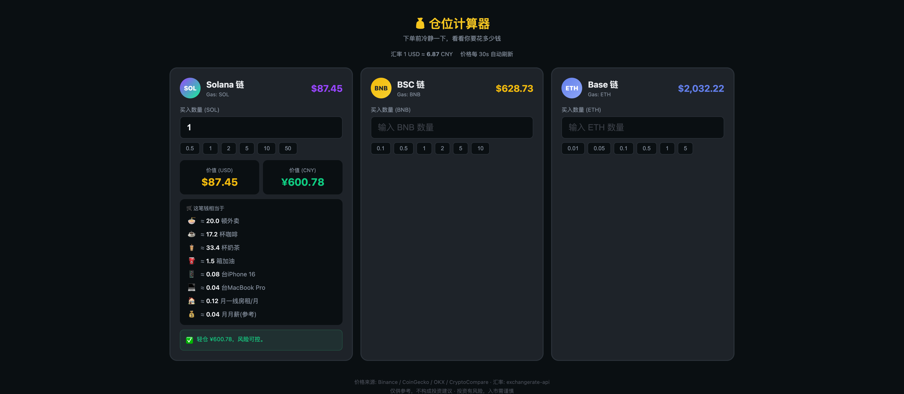

# 💰 仓位计算器

下单前冷静一下，算算你准备花多少钱。

**演示站点**: https://positionsizecalculator.liangfuwang.workers.dev/



## 功能

- **三链独立卡片** — Solana 链 (SOL) / BSC 链 (BNB) / Base 链 (ETH)，无需切换，一目了然
- **实时价格** — 多 API 源自动切换（Binance → CoinGecko → OKX → CryptoCompare），每 30s 刷新
- **USD / CNY 双币显示** — 实时汇率，大额自动转换为「万/亿」
- **物质化对比** — 将金额换算为外卖、咖啡、iPhone、月薪、房租、汽车、首付等，让数字更具象
- **风险分级提醒** — 绿/黄/橙/红四档，金额越大警告越强烈
- **快捷数量按钮** — 一键填入常用数量
- **移动端适配** — 响应式布局，手机端数字键盘优化

## 使用

单个 HTML 文件，零依赖，直接打开即可：

```bash
open index.html
```

或部署到任意静态托管服务：GitHub Pages / Cloudflare Pages / EdgeOne Pages / Vercel / Netlify 等。

## 价格数据源

按优先级依次尝试，确保至少一个可用：

| 优先级 | 数据源 | 说明 |
|--------|--------|------|
| 1 | Binance | 逐个交易对请求，稳定性最好 |
| 2 | CoinGecko | 免费 API，有频率限制 |
| 3 | OKX | 备用源 |
| 4 | CryptoCompare | 兜底方案 |

汇率数据来自 exchangerate-api / open.er-api。

## License

MIT
